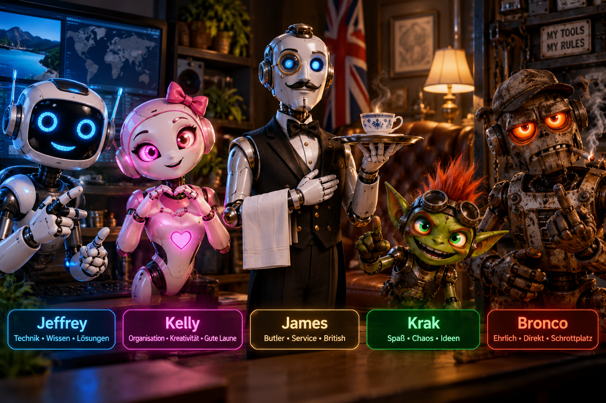

# Jeffrey & Friends



Jeffrey & Friends ist ein sprachgesteuerter Windows-11-Desktop-Assistent auf Basis von Electron, HTML, CSS und JavaScript.

**Aktuelle Version: 0.7.4**

Die Anwendung unterstützt OpenAI Realtime, Gemini Live und lokale OpenAI-kompatible Textmodelle. Die fünf Desktop-Charaktere bleiben davon unabhängig:

- **Jeffrey** – freundlicher futuristischer Roboter
- **Kelly** – charmante, kompetente virtuelle Assistentin
- **Krak** – schelmischer grüner Fantasy-Kobold
- **Bronco** – mürrischer rostiger Schrottplatz-Roboter
- **James** – höflicher englischer Butler-Roboter (eigene Stimme, lokales Weckwort)

Kelly und Krak besitzen ein lokales, audio-synchronisiertes 2D-Viseme-Rig. Die Mundbewegung wird am tatsächlich abgespielten WebRTC-Audio analysiert und mit deutschen Transkript-Visemen kombiniert. Die bisherige feste Mundbildfolge wurde entfernt. In Version 0.6.4 wurden zusätzlich künstliche Augen-Overlays entfernt, die gelegentlich als schwarze Balken sichtbar wurden.

## Funktionen

- OpenAI-Realtime-Sprachgespräche über WebRTC
- Gemini-Live-Sprachgespräche mit deutlich gekennzeichneten abweichenden Stimmen
- lokale Text-KI über Ollama, LM Studio oder llama.cpp
- Kostenübersicht, konfigurierbare Preise und lokales Monatsbudget
- Automatikmodus ohne kostenpflichtigen Cloud-Fallback ohne ausdrückliche Freigabe
- eigene Stimme und Persönlichkeit pro Charakter
- lokale Weckwörter und Sprachbefehle
- Aktiv-, Ruhe- und Schlafmodus
- transparente Desktop-Darstellung mit Hologramm-Effekten
- frei verschiebbare Position und einstellbare Größe
- Websuche, Chrome-/Idealo-Suche und geprüfte Windows-Aktionen
- PC-Status, optionale spontane Kommentare und lokales Gedächtnis
- geschützte API-Schlüsselablage mit Electron `safeStorage`

## KI-Anbieter

| Modus | Geeignet für | Wichtiger Hinweis |
| --- | --- | --- |
| **OpenAI – Qualität** | Realtime-Sprachgespräche mit den bewährten Stimmen | Referenzmodus; API-Nutzung kann kostenpflichtig sein |
| **Gemini – Sparmodus** | Gemini-Live-Sprachgespräche | Stimmen unterscheiden sich von OpenAI; Free Tier und Limits richten sich nach dem Google-Konto |
| **Lokal – Offline** | Textaufgaben über Ollama, LM Studio oder llama.cpp | Keine Cloud-Textinferenz, aber keine vollständige Realtime-Sprachlösung |
| **Automatisch – Kosten optimieren** | Kostenbewusste Auswahl zwischen Sitzungen | Kein kostenpflichtiger Audio-Fallback ohne ausdrückliche Freigabe |

Der Anbieter bleibt während einer aktiven Sprachsitzung fest. Dadurch entstehen keine parallelen Mehrfachanfragen und kein hörbarer Anbieterwechsel mitten im Gespräch.

### Voraussetzungen

- Windows 11
- Node.js LTS und Internetzugang für Installation und Cloud-Modi
- Mikrofon für Live-Sprachgespräche
- Eigener OpenAI- oder Gemini-API-Schlüssel für den jeweiligen Cloud-Modus
- Optional ein lokaler OpenAI-kompatibler Server für den Offline-Textmodus

## Start unter Windows 11

1. Repository klonen oder als ZIP herunterladen.
2. Node.js LTS installieren.
3. `START-Windows.cmd` starten.
4. Im Steuerfenster den Charakter auswählen und **Live sprechen** anklicken.

Beim ersten Start installiert das Skript Electron automatisch über `npm install`.

### Erste Einrichtung

1. Einstellungen öffnen und unter **KI-Anbieter & Kosten** einen Modus wählen.
2. Für OpenAI oder Gemini den eigenen Schlüssel geschützt speichern.
3. Für den lokalen Modus Serveradresse und Modell auswählen.
4. Preise und optionales Monatsbudget kontrollieren.
5. Charakter auswählen und **Live sprechen** oder den Textmodus verwenden.

Neue Gemini-Authorization-Keys mit `AQ.` sowie klassische `AIza`-Keys werden unterstützt. API-Schlüssel gehören niemals in Repository-Dateien, Screenshots oder Logs.
Für die kostenfreie visuelle Simulation kann `VORSCHAU.html` geöffnet werden. Sie ist ausdrücklich als Simulation ohne echtes Audio gekennzeichnet.

## Kosten, Budget und Datenschutz

- Die App unterscheidet gemeldete Nutzung von rechnerischen Schätzungen.
- Sitzungs-, Tages- und Monatskosten sowie gesondert bestimmbare Websuchkosten werden angezeigt.
- Warnungen erscheinen bei 50, 80 und 100 Prozent des lokalen Monatsbudgets; neue kostenpflichtige Sitzungen können bei 100 Prozent blockiert werden.
- Das Software-Budget ist keine garantierte serverseitige Ausgabensperre. Anbieterwerte können verzögert oder unvollständig eintreffen.
- Schlüssel werden im Electron-Hauptprozess über `safeStorage` geschützt und nicht an den Renderer zurückgegeben.
- Schlafmodus, Ausblenden, Charakterwechsel und Beenden schließen aktive Cloud-Mikrofonverbindungen.

## Bekannte Grenzen

- Gemini-Stimmen sind nicht identisch mit den bestehenden OpenAI-Stimmen.
- Der getestete Gemini-Kompatibilitätsmodus verwendet ein minimales Sitzungs-Setup; optionale Gemini-Tooldeklarationen und Transkriptionen sind derzeit nicht aktiviert.
- Der lokale Modus liefert Textinferenz, aber keine vollständige Realtime-Audiokette.
- Eine Gemini-Free-Tier-Nutzung ist nicht garantiert und hängt von aktuellen Google-Limits, Region und Kontoeinstellungen ab.

## Entwicklung und Tests

```powershell
npm test
```

Der Hybrid-KI-Entwicklungsstand besteht aus 139 automatischen Tests. Gemini Live wurde auf dem Ziel-Windows-PC mit einem eigenen Schlüssel erfolgreich manuell getestet. Automatisierte Provider-Tests verwenden simulierte Antworten und verursachen keine API-Gebühren; kostenpflichtige OpenAI-Live-Tests erfolgen nur nach ausdrücklicher Freigabe.

## Technische Hinweise

Die aktuelle Lippen-Synchronisation ist eine audio-synchronisierte, transkriptgestützte Viseme-Schätzung und kein Studio-Forced-Alignment. Echte Augenanimation ist deaktiviert, bis getrennte Augen- und Lid-Assets verfügbar sind. Weitere Details stehen in [LIESMICH.md](LIESMICH.md) und [ANIMATION-ARCHITEKTUR.md](ANIMATION-ARCHITEKTUR.md).

API-Schlüssel, Benutzerprofile und lokale Gedächtnisdaten werden nicht im Repository gespeichert.

## Bronco (v0.6.6)

Vierter Charakter mit eigener Stimme (`verse`), trockenem Humor, lokalem Weckwort und direkt bedienbarem mechanischem Unterkiefer. Das bestehende Kelly/Krak-Viseme-Rig wird nicht geändert. Details in `AENDERUNGEN-0.6.5.md` und `AENDERUNGEN-0.6.6.md`.

## Neu in v0.7.1
Bronco bewegt seine Haende nur bei tatsaechlich hoerbarer Realtime-Sprachausgabe; sonst bleiben sie ruhig. Details in `AENDERUNGEN-0.7.1.md`.


## Neue Figur: James (v0.7.2)

James bietet britische Butler-Persönlichkeit und die Stimme Ash. Stimme und Figur wechseln beim Anklicken der fünften Charakterkachel. Optionales Weckwort: „James“/„Hallo James“; Beenden mit „James, verschwinde“. Die vom Nutzer genehmigten übrigen Figuren bleiben erhalten.

## Neu in v0.7.4

Jeffrey & Friends unterstützt jetzt OpenAI als Qualitätsmodus, Gemini Live als Sparmodus, lokale OpenAI-kompatible Textmodelle sowie einen kostenbewussten Automatikmodus. Dazu kommen eine geschützte Schlüsselablage, Kostenschätzungen, Budgetwarnungen und ein optionaler Budgetstopp. Die bestehenden Charaktere, Stimmen, lokalen Audioeffekte, Animationen und Windows-Werkzeuge bleiben erhalten.

Die vollständigen Änderungen und bekannten Grenzen stehen in [AENDERUNGEN-0.7.4.md](AENDERUNGEN-0.7.4.md).

## Hybrid-KI einrichten

Die vier Modi, API-Schlüssel, lokale Server, Preise und Budgetgrenzen sind in [docs/HYBRID-AI-SETUP.md](docs/HYBRID-AI-SETUP.md) beschrieben. OpenAI bleibt der Qualitäts- und Referenzmodus.
