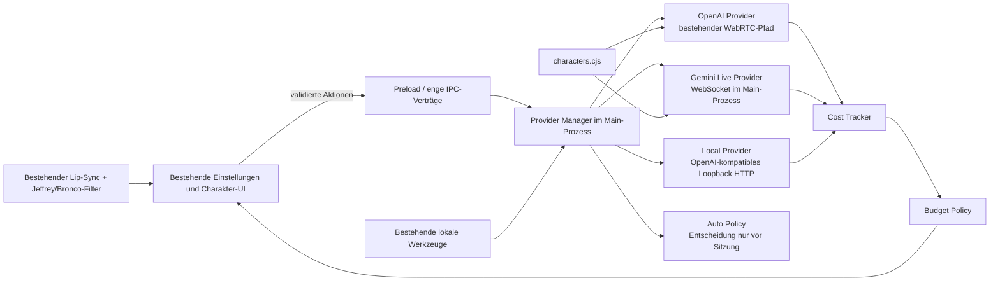

# Hybrid-KI und API-Kostenoptimierung – Systemdesign

## Architecture Overview

Die neue Schicht sitzt zwischen bestehender UI/Charakterlogik und den externen bzw. lokalen Modellen. Werkzeuge, Charakterprofile, Animation und Audioeffekte bleiben außerhalb der Provider.



### Verantwortlichkeiten

- `provider-manager.cjs`: Auswahl und Session-Lock, Providerfähigkeiten, Automatikentscheidung, kein kostenpflichtiger Fallback ohne Freigabe.
- `providers/openai-provider.cjs`: dünner Adapter um bestehende OpenAI-Text-/Realtime-Funktionen; keine Audioverhaltensänderung.
- `providers/gemini-live-provider.cjs`: Gemini-Live-WebSocket, Setup, PCM-Pakete, Tool-/Nutzungsereignisse und Cleanup ausschließlich im Hauptprozess.
- `providers/local-provider.cjs`: OpenAI-kompatible Textinferenz an validierter Loopback-Adresse und Modellauflistung.
- `cost-tracker.cjs`: normalisierte Nutzungsereignisse, lokale Aggregation und Kostenberechnung.
- `secure-keys.cjs`: getrennte DPAPI-Dateien je Cloud-Anbieter, keine Secret-Ausgabe in den Renderer.
- bestehende UI-Dateien: zusätzliche Einstellungen und Statusanzeige, ohne Änderung an Charakterdarstellung oder Effektreglern.

## Data Models

### ProviderSettings

```js
{
  aiProvider: 'openai' | 'gemini' | 'local' | 'auto',
  localBaseUrl: 'http://127.0.0.1:11434/v1',
  localModel: '',
  geminiModel: 'gemini-3.8-live',
  autoPaidFallback: false,
  monthlyBudgetEur: 0,
  blockPaidAtBudget: false,
  pricing: { /* EUR je 1 Mio. Tokens bzw. je 1000 Aufrufe */ }
}
```

`monthlyBudgetEur: 0` bedeutet keine lokale Grenze. Alle Werte werden zentral durch `normalizeSettings` begrenzt. Bestehende unbekannte Felder werden nicht in IPC-Geheimnisse umgewandelt.

### UsageEvent

```js
{
  id, timestamp, sessionId,
  provider: 'openai' | 'gemini' | 'local',
  model,
  category: 'text' | 'audio' | 'web_search',
  source: 'reported' | 'estimated',
  units: { inputTextTokens, outputTextTokens, inputAudioTokens, outputAudioTokens, requests },
  estimatedCostEur,
  pricingVersion: '2026-10-24'
}
```

Die persistierte Datei enthält keine Prompts, Transkripte, Schlüssel oder Audiodaten. Summen werden aus begrenzten Events neu berechnet; alte Detailereignisse werden nach Aggregation verworfen.

### CostSummary

```js
{
  activeProvider, model,
  session: { amountEur, quality },
  day: { amountEur, quality },
  month: { amountEur, quality },
  byProvider: {},
  webSearch: {},
  budget: { limitEur, ratio, threshold, blocksNewPaidSessions },
  disclaimer
}
```

`quality` ist `reported`, `estimated`, `mixed` oder `none`; niemals wird der Wert als offizieller Rechnungssaldo bezeichnet.

## API Design

### Provider-Vertrag

```js
{
  id,
  capabilities: { text, realtimeAudio, tools, reportedUsage },
  healthCheck(context),
  reply(request, context),
  startRealtime(session, context),
  stopRealtime(reason)
}
```

Provider erhalten ein freigegebenes Charakterprofil und Werkzeugdefinitionen, aber keine Renderer-Objekte. Sie liefern normalisierte Text-, Audio-, Status- und Nutzungsereignisse.

### IPC-Verträge

- `robot:provider-status`: liefert nur `hasOpenAIKey`, `hasGeminiKey`, Fähigkeiten, ausgewählte Modelle und Kostenübersicht.
- `robot:provider-key-save` / `robot:provider-key-clear`: validiert Anbieter und Schlüssel im Hauptprozess; Rückgabe enthält nur Erfolgstext.
- `robot:local-models`: liest Modelle nur von validierter Loopback-Adresse.
- `robot:realtime-connect`: bleibt OpenAI-WebRTC-kompatibel.
- `robot:gemini-start`, `robot:gemini-audio`, `robot:gemini-stop`: enger Gemini-Audiokanal; Base64/PCM-Größe und Frequenz werden begrenzt.
- `robot:gemini-event`: ausschließlich normalisierte Status-, Audio-, Transkript- und Nutzungsdaten, niemals Schlüssel oder rohe Fehlerobjekte.

Alle IPC-Handler prüfen den Absender gegen das Einstellungsfenster, den Modus, die aktive Session-ID und Größenlimits.

## Component Breakdown

### OpenAI

- Bestehender WebRTC-Aufbau und SDP-Validierung bleiben erhalten.
- `response.done.response.usage` wird im Renderer erkannt und als begrenztes Nutzungsereignis an den Hauptprozess gemeldet.
- Lip-Sync bleibt an den echten Remote-MediaStream gebunden.
- Jeffrey- und Bronco-Filterdateien werden nicht verändert.

### Gemini

- API-Schlüssel bleibt im Hauptprozess. WebSocket-URL und Setup werden dort erzeugt.
- Renderer nimmt Mikrofon-PCM auf und spielt 24-kHz-PCM aus normalisierten Ereignissen ab.
- Session-Setup enthält Charakteranweisung und freigegebene Werkzeuge. Werkzeugausführung bleibt in den bestehenden Main-Prozess-Handlern.
- Abweichende Stimme wird in UI und Status klar ausgewiesen; keine Behauptung einer identischen OpenAI-Stimme.
- Verbindungsfehler schließen Recorder, Player und Socket ohne automatischen Anbieterwechsel.

### Lokal

- URL-Parser akzeptiert nur HTTP(S), Loopback-Hostname und gültigen Port; Query, Credentials und Fragmente sind verboten.
- Unterstützt `/models` und `/chat/completions` unter einem konfigurierbaren `/v1`-Basispfad.
- Modell wird explizit gewählt; bei leerer Auswahl kann das erste gemeldete Modell nur nach erfolgreicher Modellabfrage verwendet werden.
- Textantworten nutzen weiter vorhandene Windows-Sprachausgabe, falls aktiviert. Dies wird als getrennte lokale TTS-Funktion benannt, nicht als Realtime-Audio.

### Automatik

Entscheidungsreihenfolge vor einer neuen Sitzung/Anfrage:

1. Lokale Windows-, Browser-, Idealo- und PC-Status-Befehle bleiben lokal.
2. Text: erreichbarer lokaler Provider; andernfalls lokale Offline-Antwort.
3. Sprache: konfigurierter günstiger Audioanbieter, wenn Schlüssel und Budget vorhanden sind.
4. OpenAI nur, wenn `autoPaidFallback` ausdrücklich aktiviert wurde und die Budgetprüfung erlaubt.

Der gewählte Provider wird in einer Session-ID gesperrt. Fehler führen zum Ende oder zu einer Nutzerentscheidung, nicht zu doppelten Anfragen.

### Kosten und Budget

- OpenAI/Gemini: gemeldete Nutzungsdaten bevorzugen; nur fehlende Teile werden geschätzt.
- Lokale Inferenz: Cloudkosten 0 EUR; Strom-/Hardwarekosten werden nicht behauptet.
- Websuche ist eigene Kategorie und wird pro tatsächlich gestarteter Anfrage gezählt.
- Budgetprüfung findet vor jeder neuen kostenpflichtigen Sitzung bzw. separaten bezahlten Anfrage statt.
- Schwellen 50/80/100 werden je Kalendermonat einmal gemeldet. Das Erreichen beendet keine aktive Sitzung.
- Preiswerte sind lokale Konfiguration mit Stichtag, Währung und Plausibilitätsgrenzen.

## Design Decisions

### Gewählte Alternativen

1. **Gemini-Key im Hauptprozess statt Renderer-Key.** Alternative wären direkte Browser-WebSockets mit Key oder kurzlebigen Tokens. Der Main-Prozess reduziert Secret-Exposition und passt zur vorhandenen Sicherheitsgrenze; Ephemeral Tokens können später ergänzt werden.
2. **Bestehenden OpenAI-Pfad kapseln statt neu schreiben.** Ein vollständiger einheitlicher Audiotransport wäre konzeptionell sauberer, gefährdet aber Stimmen, Filter und Lip-Sync. Stabilität hat Vorrang.
3. **Loopback-only lokal statt frei konfigurierbarer URL.** LAN-/Cloud-Endpunkte wären flexibler, erhöhen jedoch SSRF-, Datenschutz- und Kostenrisiko. Erweiterung kann später mit expliziter Vertrauensliste erfolgen.
4. **Ereignisbasierte lokale Kostendatei statt Telemetrie-Backend.** Das schützt Privatsphäre und funktioniert offline; dafür bleibt die Anzeige eine lokale Schätzung.
5. **Session-Lock statt dynamischem Mid-Conversation-Routing.** Verhindert doppelte Gebühren, Audioartefakte und Charakterwechsel während einer Antwort.
6. **Deterministische Automatik statt LLM-Router.** Vermeidet eine zusätzliche kostenpflichtige Klassifikationsanfrage und macht Entscheidungen testbar.

### Bewusst nicht umgesetzt

- Kein stiller Cross-Provider-Retry.
- Kein Cloud-Preisabruf beim Start.
- Kein Speichern von Gesprächsinhalten zur Kostenberechnung.
- Kein Umbau der Charakter- oder Animationsmodule.

## Non-Functional Requirements

- **Sicherheit:** CSP bleibt restriktiv; Schlüssel nur über `safeStorage`; sanitierte Fehler; begrenzte IPC-Nachrichten; Loopback-Validierung; kein Shell-Aufruf durch Provider.
- **Zuverlässigkeit:** Stop ist idempotent; Schlafmodus, Ausblenden, Fenster-/App-Ende und 45-Sekunden-Inaktivität schließen Audio und Netzwerk.
- **Kompatibilität:** bestehende Settings werden migriert; OpenAI ist Standard; alte lokale Konfiguration nutzt sichere Defaults.
- **Leistung:** Audio-Chunks sind begrenzt und werden nicht persistiert; Kostenaggregation ist linear in einer begrenzten Ereignismenge.
- **Testbarkeit:** Netzwerk, Uhr, Dateisystem, Schlüsselablage und WebSocket sind injizierbar; Tests verwenden ausschließlich Mocks.
- **Datenschutz:** keine Prompts oder Audiodaten im Kostenlog; klare Hinweise zu Google Free/Paid Data Use und regionaler Verfügbarkeit.
- **Beobachtbarkeit:** Nutzer sieht Anbieter, Modell, Status, Kostenqualität und Budgetwarnungen; Logs enthalten keine Schlüssel oder vollständigen Anbieterantworten.
